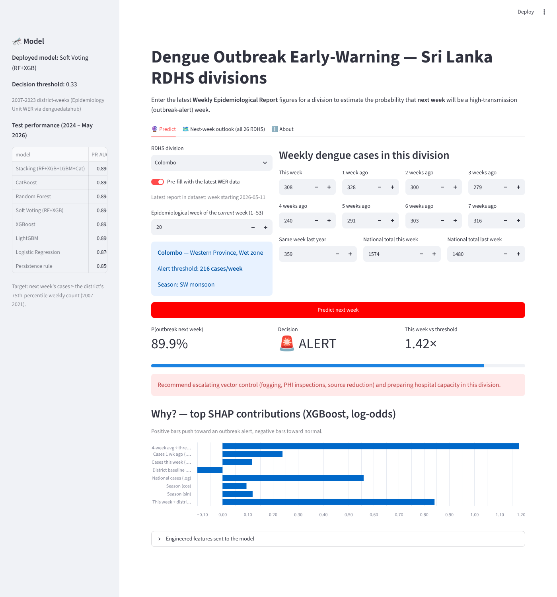

# Dengue Outbreak Early-Warning for Sri Lanka 🦟

**Applied Machine Learning – Class Activity (Random Forest vs XGBoost) extended into the Final Assignment**

Predict, one week ahead, whether each of Sri Lanka's 26 RDHS health divisions will have a **high-transmission
dengue week** (next week's cases ≥ the district's own 75th-percentile weekly count). The model uses the Ministry of
Health Epidemiology Unit's weekly reports from 2006 to 2026, and a Streamlit front end lets an officer type in the latest figures
and get a prediction with an explanation.



## Results (untouched test set: 2024 – May 2026, 3,170 district-weeks)

| Model | ROC-AUC | PR-AUC | F1 | Recall |
|---|---|---|---|---|
| Persistence rule (current practice) | 0.840 | 0.850 | 0.795 | 0.796 |
| Logistic Regression | 0.867 | 0.870 | 0.804 | 0.798 |
| Random Forest (tuned) | 0.880 | 0.894 | 0.816 | 0.901 |
| XGBoost (tuned) | 0.881 | 0.892 | 0.822 | 0.909 |
| LightGBM | 0.876 | 0.890 | 0.811 | 0.908 |
| CatBoost | 0.882 | 0.896 | 0.818 | 0.904 |
| **Soft Voting RF + XGB (deployed)** | **0.881** | **0.894** | **0.818** | **0.910** |
| Stacking (RF+XGB+LGBM+CatBoost → LR) | 0.883 | 0.896 | 0.820 | 0.905 |

The deployed model was chosen on the 2022–23 validation period, not on these test scores. The full discussion is in [`REPORT.md`](REPORT.md).

## Repository layout

```
├── data/raw/srilanka_weekly_dengue.csv     # 26,311 district-weeks, Dec 2006 – May 2026
├── src/features.py                         # cleaning + feature engineering (shared by notebook & app)
├── src/cb_wrapper.py                       # sklearn-compatible CatBoost wrapper (for stacking/pickling)
├── notebooks/dengue_outbreak_ml.ipynb      # executed notebook: EDA → models → SHAP/LIME → inference
├── notebooks/build_notebook.py             # script that generates the notebook
├── models/dengue_outbreak_model.pkl        # deployed bundle (model + thresholds + metadata)
├── models/model.pkl                        # soft-voting RF+XGB ensemble (lecture notebook format)
├── models/xgb_model.pkl                    # tuned XGBoost pipeline
├── app/app.py                              # Streamlit front end (pickle loader + UI)
├── reports/                                # figures, validation/test metrics, next-week forecast
├── REPORT.md                               # assignment write-up
├── GENAI_PROMPTS.md                        # prompts used to generate the front end
├── Dockerfile, requirements*.txt           # reproducibility / deployment
```

## Run it

```bash
pip install -r requirements.txt
streamlit run app/app.py                       # front end at http://localhost:8501
jupyter notebook notebooks/dengue_outbreak_ml.ipynb   # re-run the analysis (~15 min on 2 CPU cores)
```

Docker (for the deployment bonus, e.g. Azure Container Apps or Streamlit Community Cloud):

```bash
docker build -t sl-dengue-ews .
docker run -p 8501:8501 sl-dengue-ews
```

> The pickles were produced with the exact library versions in `requirements.txt`. Use the same versions when loading them.

## Data source

Epidemiology Unit, Ministry of Health, Sri Lanka: *Weekly Epidemiological Report*, district dengue notifications.
The data was compiled from the WER PDFs by the open-source R package
[`denguedatahub`](https://github.com/thiyangt/denguedatahub) (T. Talagala et al.), object `srilanka_weekly_data`,
and exported to CSV for this project.
