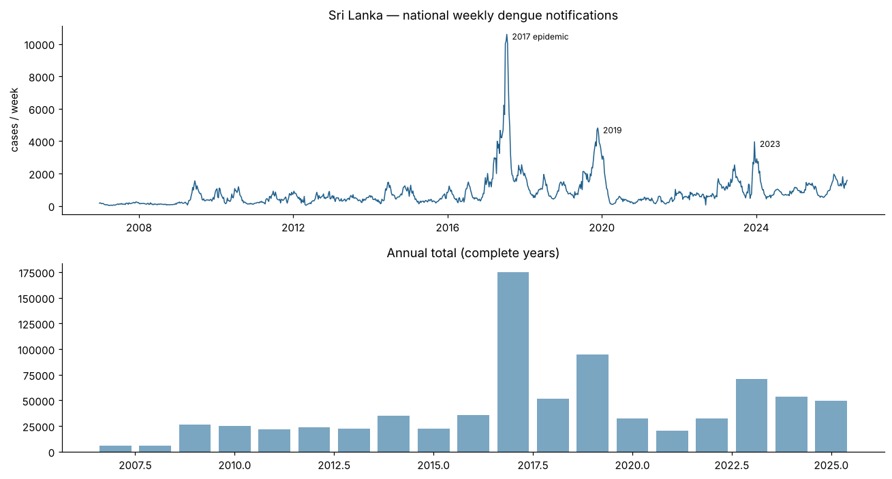
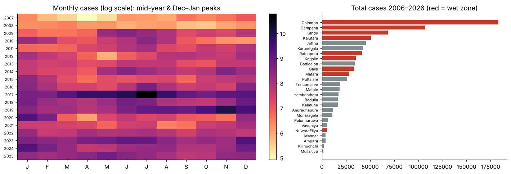
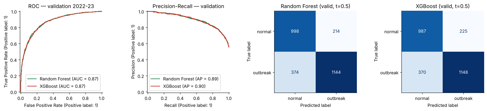
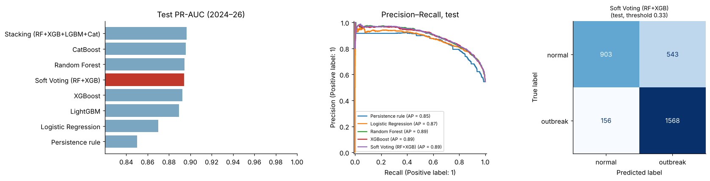
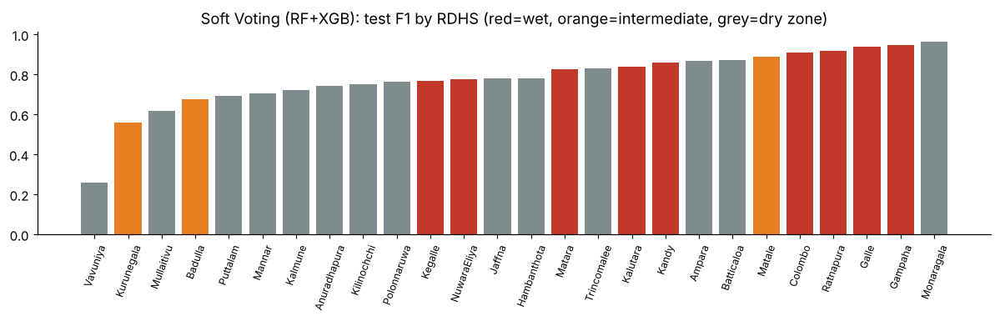
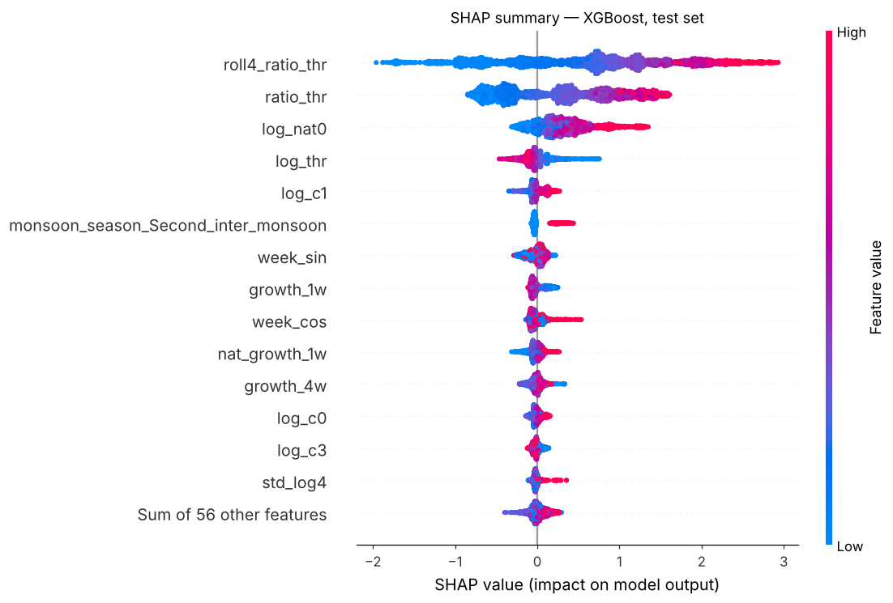
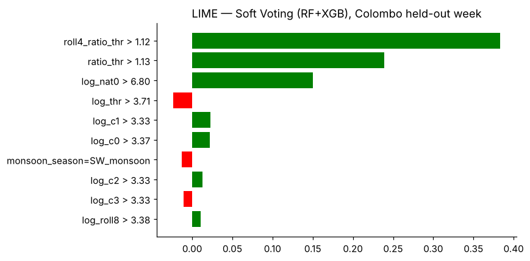
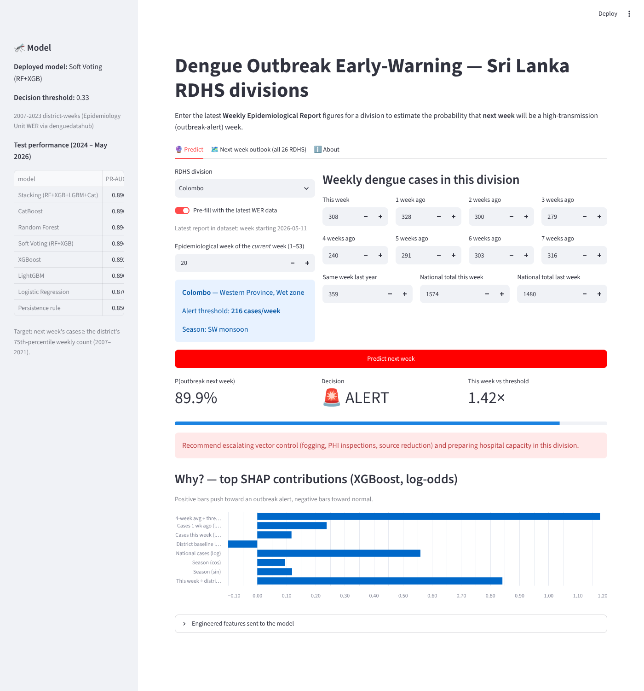

# Dengue Outbreak Early-Warning for Sri Lanka's RDHS Divisions
**Applied Machine Learning: Class Activity (Part 1) and Final Assignment (Part 2)**
Author: Dimuthu

---

## 1. Problem and local context

Dengue is Sri Lanka's most burdensome vector-borne disease. This dataset alone records 174,687 notifications in
the 2017 epidemic and about 71,000 in 2023. Each week the **Epidemiology Unit (Ministry of Health)** publishes the
*Weekly Epidemiological Report (WER)* with dengue notifications for the 26 **RDHS** divisions. RDHS and MOH offices must
then decide where to send fogging teams, Public Health Inspectors and extra hospital capacity.

**ML task (binary classification):** at the end of week *t*, predict whether week *t+1* will be a
*high-transmission week* for that division:

> `outbreak_next_week = 1` if next week's cases ≥ the division's **own 75th-percentile weekly count over 2007–2021**.

Using a separate threshold for each district means each division is compared with its own normal level. Colombo's threshold is 216
cases a week and Mullaitivu's is 2. The task is framed as classification because the operational decision is binary
(escalate or not) and the weekly counts are very skewed (0 to 2,631).

## 2. Data collection and quality

| Item | Detail |
|---|---|
| Source | Epidemiology Unit WER, district dengue notifications, compiled from the PDFs by the `denguedatahub` R package |
| Size | 26,311 rows = 26 RDHS × 1,012 weeks (23 Dec 2006 → 11 May 2026) |
| Columns | year, week, start/end date, district, cases |

**Quality checks (notebook §1):**

- No nulls, duplicates or negative counts in the raw data.
- Puttalam is missing one week (Feb 2026), and three report dates shift by ±1–2 days at year boundaries. Both are harmless.
- **Outlier detection:** I found 22 isolated one-week collapses such as Colombo 316 → **9** → 291 (March 2026) and
  Gampaha 194 → **10** → 145. Transmission can't stop for exactly one week and then resume, and the values (9, 10, 11, 12)
  look like a dropped digit during transcription. I flagged them with a rule: both neighbouring weeks ≥ 50 and the week < 15 % of the smaller
  neighbour. They were replaced by the geometric mean of the two neighbours. That is 0.08 % of rows.
- High outliers (epidemic peaks) are real, so I kept them and handled them with a `log1p` transform rather than clipping.

## 3. Exploratory analysis (notebook §2)

- **Strong persistence:** the autocorrelation of log cases is 0.83 at lag 1 and 0.70 at lag 4. The persistence rule is
  therefore a strong baseline.
- **Two seasonal peaks** that follow the **South-West monsoon (May–Jul)** and the **North-East monsoon (Dec–Jan)**.
- **Western Province accounts for 40.8 % of all cases.** Wet-zone and urban divisions dominate the totals.
- **Regime changes:** the 2017 epidemic, low reporting during COVID-19 (2020–21), and a higher burden after 2022. The share
  of positive weeks rises from **26 % (2007–21) to about 55 % (2022–26)**. This is prior/concept drift, so the evaluation has to be **temporal**.

## 4. Preprocessing and feature engineering (notebook §3–5)

Every feature at row *t* uses only information available at the end of week *t*. The thresholds are computed from training years only.

| Group | Features | Domain reasoning |
|---|---|---|
| Recent burden | log cases t, t-1, t-2, t-3; 4- and 8-week log means; 4-week volatility | autocorrelation, plus the incubation and reporting lag |
| Momentum | 1-week and 4-week growth | an outbreak shows up as acceleration, not just a high level |
| Relative level | cases ÷ threshold, 4-week mean ÷ threshold, log threshold | puts large and small divisions on one scale |
| Seasonality | sin/cos of week, monsoon season (4 classes), same week last year | monsoon-driven mosquito breeding |
| Geography | district, province, agro-climatic zone (wet/intermediate/dry) | differences in rainfall and urbanisation |
| National context | log national cases, national 1-week growth | island-wide waves (for example, a serotype shift) |

Preprocessing runs inside sklearn `Pipeline`s, so it is learned only on the training folds:

- **Null handling and imputation:** lags at the start of each series and *same week last year* in 2007 are missing.
  They are filled with `SimpleImputer(median, add_indicator=True)`.
- **Transformation:** `log1p` on counts, and cyclical sin/cos encoding for the week.
- **Scaling:** `StandardScaler` for logistic regression. Tree models don't need scaling.
- **Encoding:** one-hot encoding for RF, XGBoost and LightGBM. CatBoost uses its native categorical handling.
- **Consistency test:** the front-end feature builder reproduces 200 random training rows exactly (max difference 0.0).

**Split:** train 2007–2021 (20,384 rows), validation 2022–23 (2,730), test 2024–May 2026 (3,170), plus **one held-out
sample** (Colombo, week of 4 May 2026) that is never used for training or testing.

## 5. Part 1: Random Forest vs XGBoost with designed hyper-parameters

I didn't use default parameters. I designed a range for each one from the data (reasoning in notebook §7), then a
`RandomizedSearchCV` with **`TimeSeriesSplit(4)`** optimised PR-AUC within that range.

| | Selected values |
|---|---|
| **Random Forest** | `n_estimators=300, max_depth=20, min_samples_leaf=20, max_features=0.3, max_samples=0.6, class_weight=None` |
| **XGBoost** | `n_estimators=300, learning_rate=0.02, max_depth=5, min_child_weight=10, subsample=0.8, colsample_bytree=0.75, reg_lambda=1, gamma=0, scale_pos_weight=1` |

The search chose regularised settings for both models. The forest uses large leaves and feature/row sub-sampling, and
XGBoost uses slow learning with a high minimum child weight. This fits noisy weekly counts.

| Validation 2022–23 | ROC-AUC | PR-AUC | F1@0.5 | Brier | Train PR-AUC | Fit time |
|---|---|---|---|---|---|---|
| Random Forest | 0.869 | 0.895 | 0.796 | 0.149 | 0.907 | 6.2 s |
| XGBoost | 0.869 | 0.895 | 0.794 | 0.149 | 0.903 | 1.0 s |

**Interpretation:** the two models are statistically indistinguishable on this problem. The main signal (current level
relative to the threshold, plus trend) is smooth and low-dimensional, so both bagging and boosting capture it. The
train-vs-validation gap is small for both, so neither overfits after tuning.

| | Random Forest (bagging) | XGBoost (boosting) |
|---|---|---|
| **Strengths** | Robust to noisy counts and epidemic outliers. Few sensitive parameters. Parallel training. Stable. | Top-tier accuracy on tabular data. L1/L2 regularisation. `scale_pos_weight` for imbalance. Native handling of NaN values. About 6× faster to train and about 35× smaller pickle. |
| **Limitations** | Large model (26 MB). Averaging compresses probabilities toward 0.5, so the threshold needs tuning. Impurity importance is biased. Can't extrapolate beyond seen levels. | More hyper-parameters, and overfits easily when `learning_rate` or `max_depth` are set badly. Sequential, so slower to tune. Also can't extrapolate trends. |

## 6. Part 2: model selection and comparison with existing approaches

**Existing approaches (baselines):**

1. **Persistence rule:** "alert next week if this week is already above threshold". This is what an officer reading the WER would do.
2. **Seasonal naive:** last year's value for the same week.
3. **Logistic regression.**

**Advanced models:**

- **Soft voting** of RF and XGB (the lecture's pipeline).
- **LightGBM** (leaf-wise boosting).
- **CatBoost**, chosen because there are 4 categorical features.
- **Stacking** of RF, XGB, LightGBM and CatBoost, with a logistic-regression meta-learner trained on out-of-fold probabilities.

Each model's decision threshold was tuned for F1 on validation. All models were then refit on 2007–2023 and evaluated once on the test period:

| Test 2024 – May 2026 | ROC-AUC | PR-AUC | F1 | Precision | Recall | Brier |
|---|---|---|---|---|---|---|
| Persistence rule | 0.840 | 0.850 | 0.795 | 0.793 | 0.796 | 0.164 |
| Logistic Regression | 0.867 | 0.870 | 0.804 | 0.809 | 0.798 | 0.164 |
| Random Forest | 0.880 | 0.894 | 0.816 | 0.746 | 0.901 | 0.142 |
| XGBoost | 0.881 | 0.892 | 0.822 | 0.750 | 0.909 | 0.141 |
| LightGBM | 0.876 | 0.890 | 0.811 | 0.733 | 0.908 | 0.142 |
| CatBoost | 0.882 | 0.896 | 0.818 | 0.748 | 0.904 | 0.154 |
| **Soft Voting RF+XGB (selected)** | **0.881** | **0.894** | **0.818** | **0.743** | **0.910** | **0.141** |
| Stacking | 0.883 | 0.896 | 0.820 | 0.749 | 0.905 | 0.138 |

**Justification of the choice:**

- Every ensemble beats the existing approaches: about **+0.04 PR-AUC over the persistence rule** and about +0.02 over logistic
  regression. They also catch **about 11 percentage points more outbreak weeks** (recall 0.91 vs 0.80) at a slightly
  higher F1.
- **Soft voting** had the best *validation* PR-AUC (0.896), so it was selected before looking at the test set. On test it is
  within 0.002 of the best models. Stacking and CatBoost score marginally higher, but stacking takes about 18× longer to train
  and isn't meaningfully better. The simpler, faster voting ensemble is the better engineering trade-off.
- The decision threshold of **0.33** deliberately favours recall. In public health, a missed outbreak costs more than
  one extra inspection round. At this threshold the model raises 2,111 alerts on the test period. 1,568 of them are correct, and only 156 of the 1,724 outbreak weeks are missed.
- **Where it works:** wet-zone divisions reach F1 ≈ 0.87. Dry and intermediate-zone divisions reach ≈ 0.71–0.74, because
  small counts (thresholds of 2–16 cases a week) are noisy.

## 7. Interpreting the model: SHAP and LIME

- **Global (SHAP, XGBoost):** the most influential features are **4-week average ÷ threshold**, then **this week ÷
  threshold**, then the **national case level**. These are followed by the district's baseline, last week's cases and seasonality.
  A higher recent burden relative to normal pushes the prediction strongly toward an outbreak. The **second inter-monsoon
  season (Oct–Nov)** raises risk ahead of the Dec–Jan peak.
- Very large 1-week growth slightly *reduces* risk, because a single-week spike tends to revert. A high 4-week average
  relative to normal is what drives alerts. This is useful for officers to know.
- **Permutation importance** on the deployed ensemble confirms the two dominant drivers (4-week average ÷ threshold and this
  week ÷ threshold). National cases rank lower there, because their information overlaps with the correlated lag features.
- **Local (held-out Colombo week):** the SHAP waterfall and **LIME** (surrogate R² = 0.81) agree.
  `roll4_ratio_thr > 1.12`, `ratio_thr > 1.13` and high national cases are the main reasons for the alert. Being in the SW
  monsoon and Colombo's large baseline reduce it slightly. LIME explains the **voting ensemble directly**, because it only needs `predict_proba`.

## 8. Single-sample inference and next-week forecast

The deployed bundle is reloaded from `models/dengue_outbreak_model.pkl` and given the held-out point:

> Colombo, week starting 4 May 2026: 328 cases (threshold 216.5) → **P(outbreak next week) = 0.88 → OUTBREAK ALERT**.
> The actual count next week was 308 → outbreak, so the prediction was **correct**.

The model also produces a genuine forecast for the week after 11 May 2026, saved in `reports/next_week_forecast.csv`.
23 of the 26 divisions are flagged, which matches the start of the SW-monsoon season during a high-burden year. The highest
probabilities are for Matara, Ratnapura, Galle and Kalutara (≥ 0.99). Jaffna, Puttalam and Vavuniya are below the threshold.

## 9. Front end and deployment

- `app/app.py` is a **Streamlit** app generated from the prompts in `GENAI_PROMPTS.md` and then reviewed. It has
  three tabs:
  - **Predict:** input boxes for the division, week, last 8 weeks of cases, same week last year and the national totals.
    It shows the probability, an alert decision, a recommendation and a SHAP bar chart.
  - **Next-week outlook:** a ranked view of all 26 divisions.
  - **About.**
- The app reuses `src/features.py`, so there is no difference between the features used in training and at serving time.
- **Bonus deployment:** a `Dockerfile` is included for Azure Container Apps (the Lecture 10 CI/CD flow) or Streamlit
  Community Cloud. The app itself was tested by running it headless, but the Docker image hasn't been built yet.

## 10. Limitations and future work

1. **No weather or population covariates.** Department of Meteorology rainfall and temperature data would add real lead time.
   This is the natural place for the suggested **ARIMA + Random Forest hybrid** or a stacking extension.
2. **Reporting artefacts.** The WER has reporting delays and transcription errors. 22 were cleaned, but the cleaning rule needs the
   following week, so it can't clean the latest week at inference time.
3. **Drift.** Positive weeks went from 26 % to about 55 % after 2022. The model should be monitored for drift and retrained (the
   Lecture 10 MLOps loop), and the alert threshold should be re-based on recent years.
4. **Persistence-heavy signal.** Most of the skill comes from current levels. The model supports epidemiologists'
   judgement; it doesn't replace it.

## Requirement checklist

| Guideline item | Where |
|---|---|
| Local Sri Lankan dataset | WER dengue data, 26 RDHS (§2) |
| Classification problem defined | §1 |
| Preprocessing: imputation, transformation, null detection, scaling | §2, §4, notebook §1 and §5 |
| RF and XGBoost with designed, non-default parameters | §5, notebook §7 |
| Comparison, strengths and limitations, interpretation | §5, §6 |
| Single-sample inference (left-out point) | §8, notebook §12 |
| `.pkl` export | `models/*.pkl` |
| GenAI front end (text boxes → prediction) | `app/app.py`, `GENAI_PROMPTS.md` |
| Stacking / hybrid (optional) | Stacking ensemble, §6 |
| Final: compared with existing approaches, justified, interpreted (SHAP and LIME) | §6, §7 |
| Bonus: deployment | `Dockerfile`, §9 |
